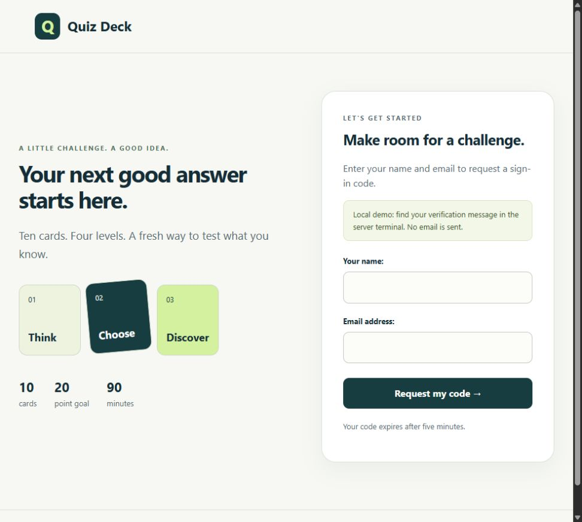
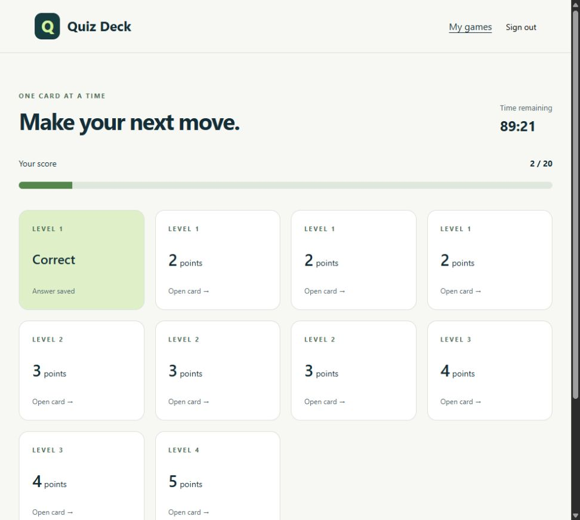

# Quiz Deck · My First Django App

[](https://github.com/jorge-barb-pereira/django-quiz-card-game/actions/workflows/django.yml)

A browser-based quiz-card game demonstrating Django models, forms, sessions, email-code verification, server-rendered templates and tested game rules. This repository presents Jorge Pereira's first Django coursework alongside a maintained English edition.

**Original development: January–February 2025.** Tutorial migration headers date from 23 January; the assessment game's migrations span 13–18 February. The maintained edition was prepared in October 2026 using Django 5.2. See [provenance](docs/PROVENANCE.md) for evidence and attribution.

## What the app does

- Verify a participant with a session-bound, expiring six-digit email code.
- Deal ten unique question cards across four difficulty levels: 4, 3, 2 and 1 cards respectively.
- Award 2–5 points per correct answer, with a maximum recorded score of 20.
- Enforce a 90-minute deadline and three started-game attempts per participant.
- Resume an active game, retain answered cards and save a personal best.
- Manage questions through Django admin, independently of participant sign-in.

The included question bank contains **20 invented arithmetic questions**, intended to demonstrate the application. No original student records, questions, local databases, credentials or course slides are included.





## Run locally

Requires Python 3.11 or newer. From the repository root:

```bash
python -m venv .venv
# Windows PowerShell: .venv/Scripts/Activate.ps1
# Linux/macOS: source .venv/bin/activate
python -m pip install -r requirements.txt
python manage.py migrate
python manage.py seed_demo
python manage.py runserver
```

Open **http://127.0.0.1:8000/**. Use a fictional name and an address such as `demo@example.invalid`. The default console email backend writes the verification message to the server terminal; it does **not** send real email. Enter that code in the browser to play.

To add your own questions locally:

```bash
python manage.py createsuperuser
```

Open `/admin/` and use the administrator account you created. No shared administrator or participant password is supplied. The seed command is idempotent and does not create accounts or import a database.

For persistent development sessions, set your own `DJANGO_SECRET_KEY` in the process environment. Without it, development mode generates an ephemeral key and existing sessions may be invalidated when the server restarts. `.env.example` documents optional variables; copying it does not automatically load them. See [configuration](docs/CONFIGURATION.md).

## Structure

```text
manage.py                Django command entry point
quizgame/                Settings, URL routing, WSGI and ASGI
game/
  models.py              Player, question, game and card records
  services.py            Atomic game creation, scoring and completion
  views.py / forms.py    Sign-in and ownership-checked browser interactions
  management/commands/   Synthetic question-bank command
  templates/ / static/   English interface, local CSS and display timer
  tests/                 Authentication, authorization and game-rule regressions
archive/                 Sanitized historical quiz and tutorial source; not executed
docs/                    Provenance, source review, configuration and validation
tools/                   Historical-source integrity and publication checks
```

The original polls, movies and API exercises are preserved under `archive/tutorials/` as learning material. They are separate from the runnable quiz and do not add runtime dependencies or routes. Original comments remain in their historical language; the maintained application and documentation are English.

## Checks

```bash
python manage.py check
python manage.py makemigrations --check --dry-run
python manage.py test game
python tools/audit_sources.py
```

GitHub Actions runs the 32 tests, migration checks, synthetic seed, static collection and deployment-setting checks on Python 3.11 and 3.12. Tests cover ownership, CSRF, expired codes/games, incorrect-code limits, duplicate submissions, score caps, attempt limits and end-to-end request flows. See [validation](docs/VALIDATION.md).

## Scope

This is an educational portfolio application and local demonstration, not a deployed examination or identity-management service. SQLite and the process-local login throttle are intended for local use. Serving a public assessment system requires a reviewed deployment, shared rate limiting, a suitable database and real email delivery. The server enforces deadlines; the browser timer is only a display. No production deployment is claimed.

The [source review](docs/REVIEW.md) records the changes from the original application. [Attribution](THIRD_PARTY_NOTICES.md) separates coursework and framework tutorial examples; no blanket license over third-party or collaborative material is asserted.
